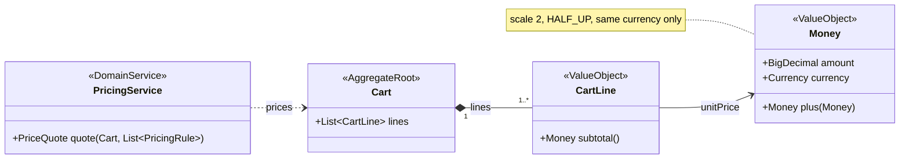

# Output templates

Use these structures for the three output files. Drop a section only when the
codebase truly has nothing for it (for example, no data store), and say so in
one line instead of leaving an empty heading.

## Contents

1. `architecture.mmd`: diagram rules
2. `ARCHITECTURE.md`: template
3. `BUSINESS_LOGIC.md`: template
4. `domain-model.mmd`: diagram rules (only when there is a domain model)
5. Mermaid syntax checklist

---

## 1. `architecture.mmd`

A `flowchart LR` (or `TB` for deep layer stacks) that shows who calls what.

Include:
- **Actors** as stadium nodes: `User([Shopper<br/>web checkout])`. Name the
  real people or systems that start requests (users, cron jobs, other
  services, queues).
- **One subgraph per deployable unit** (frontend, backend, worker, lambda).
  Inside it, **one nested subgraph per layer or module** (controllers,
  application, domain, persistence...). Use the names from the code.
- **Nodes for the important classes, files, or functions**, not for every
  file. Group small helpers: `VO["Value objects<br/>Cart · Sku · Money"]`.
  Aim for 10–35 nodes. More than that stops being readable. Split into a
  second diagram instead.
- **Data stores and external services** as cylinders: `DB[("Postgres<br/>orders")]`.
- **Edge labels** that say what flows: `-- "POST /quotes" -->`,
  `-- "findAll()" -->`, `-- "publishes OrderPlaced" -->`.
- **Dotted edges** (`-.->`) for dependencies that break the intended
  architecture (a controller that skips the service layer, a domain class
  that imports the framework). Label them so the reader knows why.

Do not draw edges you have not seen in the code. A wrong arrow is worse than
a missing one.

---

## 2. `ARCHITECTURE.md`

```markdown
# <Project name>: Architecture

<Two or three sentences: what the system is, what it is built with, and the
commit or date this describes.>

## 1. Overview
<Table of deployable units: name, path, stack + versions, port/entry point.>

## 2. Component diagram
<Paste the full content of architecture.mmd in a ```mermaid block.>
The same diagram is in [`architecture.mmd`](architecture.mmd).

## 3. Layers and modules
<Table: layer / package or folder / what lives there / key files.>

### 3.1 Dependency rules
<Which direction dependencies are meant to point, and every place the code
breaks that rule, with file:line.>

## 4. Main flows
<One mermaid sequenceDiagram per important flow (the request that carries
the core business value first). Use real class and method names. Under each
diagram, list the validation and error handling along the path.>

## 5. Data and persistence
<Stores, schemas/tables/collections, how schema is created (migrations,
ORM auto-DDL), seed data, caching, transactions.>

## 6. External interfaces
<Table of endpoints / events / CLI commands: method, path, purpose, request,
response, error codes. Include how the frontend reaches the backend
(proxy, base URL, env var).>

## 7. Configuration and runtime
<Config files, env vars, profiles, how to run locally, how tests run.>

## 8. Cross-cutting concerns
<Error handling, validation, auth, logging, i18n, money/time handling —
only what exists.>

## 9. Architectural risks
<Table: # / risk / location / consequence. Coupling, layering violations,
scaling problems (e.g. load-all-then-filter), missing boundaries, test
gaps. Order by impact.>
```

---

## 3. `BUSINESS_LOGIC.md`

Write this for someone who knows the business but not the code: a product
owner, a new developer on day one, an auditor. Code names appear in
backticks so the reader can search for them, but every rule is first stated
in plain language.

```markdown
# <Project name>: Business Logic

## 1. What problem the application solves
<Who uses it, what they get out of it, what it explicitly does NOT do.
Volumes and constraints if the docs mention them.>

## 2. Actors and use cases
<Table: actor / what they do / entry point.>

## 3. Domain concepts (glossary)
<Table: term / meaning / where in code. Include the invariants each concept
enforces, e.g. "Quantity must be > 0".>

### 3.1 Domain model
<Only when domain-model.mmd exists. Paste it in a ```mermaid block, then
add a table: building block / type (aggregate root, entity, value object,
domain service, repository, event, policy) / invariants it enforces /
file. End with a short assessment: rich or anemic model, where the
aggregate boundaries are, and where infrastructure leaks into the domain.>

## 4. Business rules
<One subsection per rule or rule family. For each:
 - the rule in one plain sentence,
 - the formula or decision table, written as code-free math or a table,
 - the conditions under which it applies,
 - a small worked example with real numbers,
 - the file:line that implements it.>

### 4.x How rules combine
<Ordering, priority, stacking, conflict resolution, limits (e.g. totals can't
go negative). This is where most bugs hide, so be explicit about what the
code actually does, not what the docs claim.>

## 5. Lifecycle and state
<States an entity goes through (created → active → deactivated, order
statuses...), who triggers each transition, and what cannot be undone.>

## 6. Reference data
<Seed or fixture data and what it means today. If it has dates, evaluate
them against today's date.>

## 7. End-to-end worked example
<Take the default or most typical input (a sample request, the seeded cart,
a test fixture) and trace it through every rule to the final output, in a
table. Compute the numbers by running the code or reproducing its exact
arithmetic, not by mental math.>

## 8. Where the code disagrees with the stated rules
<Table: # / what the docs, tickets, or names promise / what the code does /
location / business impact. Include rounding/precision issues, off-by-one
date ranges, unvalidated inputs that can break the flow, duplicated logic
(e.g. a frontend that recalculates prices). Order by business impact.>

## 9. Open questions
<Rules the code leaves ambiguous and that a domain expert should confirm.>
```

---

## 4. `domain-model.mmd`

A `classDiagram` that shows the domain model as the code implements it.

Include:
- **Stereotypes** on each class: `<<AggregateRoot>>`, `<<Entity>>`,
  `<<ValueObject>>`, `<<DomainService>>`, `<<Repository>>`,
  `<<DomainEvent>>`, `<<Factory>>`, `<<Policy>>`, `<<Enum>>`. Use a
  stereotype only when the code supports it. If a class acts as an entity
  but is also a JPA/ORM mapping, write `<<Entity · JPA>>`.
- **Namespaces** for bounded contexts or aggregates when there is more
  than one: `namespace Pricing { class PricingRule }`.
- **Key attributes and behaviour methods** only, with types:
  `+Money subtotal()`. Leave out getters, setters, and constructors.
  A class with only getters and setters is itself a finding: show that
  it has no behaviour.
- **Relationships with cardinality**:
  - composition `*--` when the parent owns the child's lifecycle
    (aggregate root → its entities and value objects),
  - association `-->` for references by object,
  - dependency `..>` for "uses" (a service uses an entity, a repository
    returns an aggregate),
  - a reference by ID to another aggregate as a dependency labelled
    `by id`.
  Example: `Cart "1" *-- "1..*" CartLine : lines`.
- **Invariants** as notes on the class that enforces them:
  `note for Quantity "value > 0"`.
- **Leaks and gaps**: when the domain depends on a framework, or a rule
  lives outside the domain (in a controller or the frontend), add a note
  that says so. Do not move it to where it "should" be.

Keep it to the domain layer, roughly 6–25 classes. DTOs, controllers, and
ORM repository implementations do not belong here. A repository
*interface* that the domain owns does.

Example skeleton:



---

## 5. Mermaid syntax checklist

Mermaid fails silently in many viewers, so check these before you finish:

- Wrap any label that contains `( ) [ ] { } : ; , / # & < > "` or
  non-ASCII in double quotes: `A["save(order)"]`.
- Use `<br/>` for line breaks inside labels, never a raw newline.
- Node IDs: letters, digits, underscore only. No spaces, no reserved words
  (`end`, `graph`, `subgraph`, `style`, `class`, `click`). `End` is fine,
  `end` is not.
- Every `subgraph` has a matching `end`.
- Edge labels: `A -- "text" --> B` or `A -->|text| B`. Quote them if they
  contain special characters.
- In `sequenceDiagram`, participant aliases are single words, and a `;` or
  `#` inside a message breaks the line. Rephrase it.
- `%%` starts a comment. Do not put `%%` inside labels.
